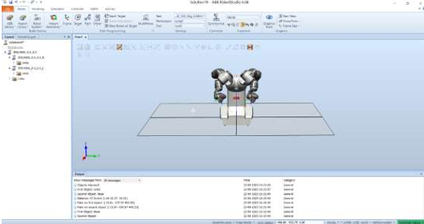
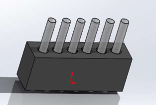
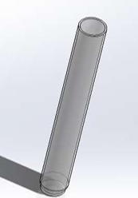

# Automated Laboratory Test Tube Handling — ABB YuMi Digital Twin

> **Digital twin modeling, custom SolidWorks 3D workstation design, and collision-free RAPID path programming of a dual-arm ABB YuMi collaborative robot for automated medical laboratory test tube handling.**

---

## 📄 Full Technical Report
👉 **[View / Download the Complete Technical Report (PDF)](docs/ABB_YuMi_Test_Tube_Handling_Report.pdf)**

---

## 🎯 Project Overview
Repetitive sample handling in medical and research laboratories consumes valuable technician time and increases the risk of human error, contamination, and exposure to hazardous materials. This project designs and validates a realistic **digital twin** of an automated laboratory workstation using an **ABB YuMi (IRB 14000)** collaborative robot in **ABB RobotStudio**, executing precise, collision-free pick-and-place transfers of test tubes between racks.

- **Institution:** Saba University — Faculty of Engineering (Mechatronics Engineering)
- **Author & Sole Technical Developer:** Afnan Aref *(Custom 3D CAD Modeling in SolidWorks, RobotStudio Digital Twin Setup, RAPID Programming & Simulation Validation)*
- **Supervision:** Dr. Mahmoud Al-Tuwaiti & Eng. Anas Hudhayf

---

## 🤖 Robotic Platform & Workstation Specifications
The **ABB YuMi IRB 14000** was selected for its human-safe collaborative design and high-precision dual-arm kinematics:

| Specification | Value |
| :--- | :--- |
| **Degrees of Freedom (DoF)** | 7-DoF per arm (Dual-Arm Cobot) |
| **Payload Capacity** | Up to $0.5\ \text{kg}$ |
| **Maximum Reach** | $559\ \text{mm}$ |
| **Position Repeatability** | $0.02\ \text{mm}$ |
| **Safety Architecture** | Built-in collaborative safety for human-robot coexistence |

### Custom 3D Workstation Components (Modeled in SolidWorks)
All workstation fixtures—including the laboratory workbench, filled source racks, empty destination racks, and individual test tubes—were **custom-modeled from scratch in SolidWorks** (not pre-made templates) and imported into ABB RobotStudio within the robot's kinematic reach envelope:

| Filled Test Tube Rack (Source) | Individual Test Tube Model |
| :---: | :---: |
|  |  |

---

## ⚙️ Methodology & RAPID Workflow
1. **3D CAD Design (SolidWorks):** Designed all custom laboratory fixtures (workbench, racks, and test tubes) from scratch with accurate physical dimensions.
2. **Station Construction (RobotStudio):** Configured a virtual ABB RobotStudio station with the IRB 14000 model and positioned the custom SolidWorks models within the dual-arm reachable workspace.
3. **Target Definition:** Defined exact 3D coordinate frames for the `Home` position, vertical approach waypoints above each tube, pick-up coordinates, and empty-rack placement targets.
4. **Path Programming (RAPID):** Programmed smooth, synchronized trajectories in ABB's **RAPID** language integrated with timed gripper open/close actuation commands.
5. **Simulation & Verification:** Executed iterative simulation runs with active **collision detection** to verify safe, repeatable, and collision-free pick-and-place operation.

---

## 🚀 Future Roadmap
- **Computer Vision Integration:** Adding vision-based tube classification and barcode/label reading.
- **LIMS Connectivity:** Automating sample sorting directly from Laboratory Information Management System (LIMS) instructions.
- **Workflow Expansion:** Integrating automated loading/unloading with centrifuges and chemical analyzers.

---

## 📌 Note on Repository Scope
*This repository serves as the engineering documentation archive for the Robotics course project, detailing the custom SolidWorks CAD models, ABB RobotStudio digital twin setup, RAPID programming methodology, and collision-free verification.*
